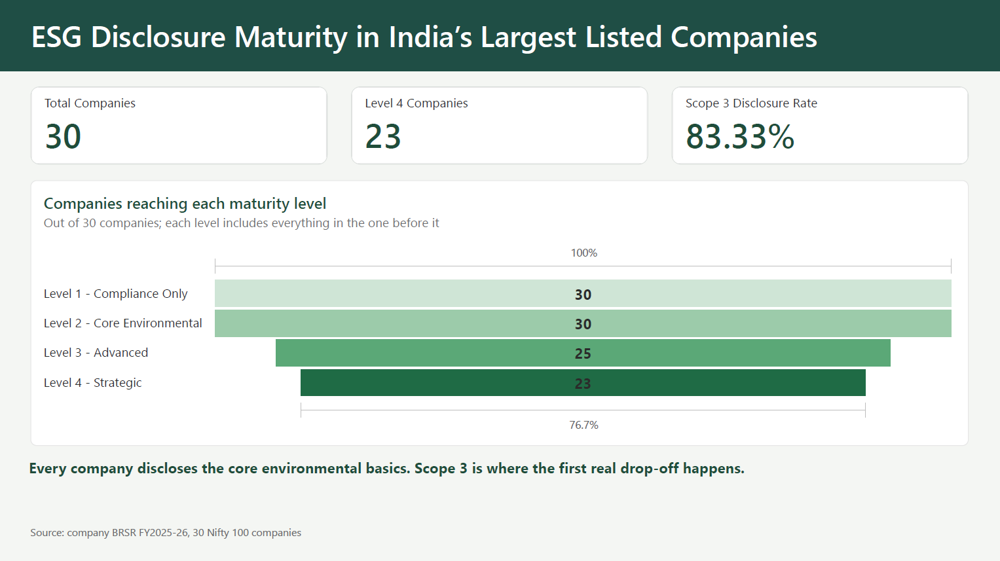
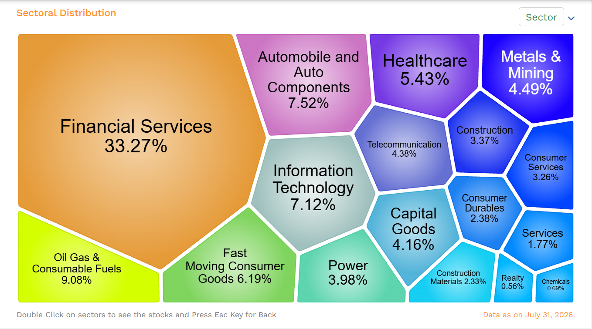

# Benchmarking ESG Disclosure Maturity in India's Largest Listed Companies

*An assessment using SEBI's Business Responsibility and Sustainability Reporting (BRSR) framework*

> **Note on the framework:** the four-level maturity framework used here is my own analytical framework. It is not an official index, a validated standard or a ranking, and it is not endorsed by SEBI or any other body.

## The question

SEBI's BRSR has standardised **that** large Indian companies report on the environment. It has not standardised **how well** they report. This project asks where the differences are, using 30 Nifty 100 companies and their FY2025-26 BRSR (Principle 6, environment).

**Short answer:** basic environmental disclosure is now universal in this sample. The differences are in Scope 3 coverage and in target quality. Every gap is a single step, and no company is missing both Scope 3 and a quantified target.

## Key results

| Level | Meaning | Companies reaching it |
|---|---|---|
| 1 | Compliance Only (BRSR filed) | 30 |
| 2 | Core Environmental (energy, water, Scope 1, Scope 2) | 30 |
| 3 | Advanced (Level 2 + Scope 3 + emissions intensity) | 25 |
| 4 | Strategic (Level 3 + a quantified target) | 23 |

The counts are cumulative: a company at Level 4 is also counted at Levels 1 to 3.

Average maturity level by sector (all-sector average 3.6): IT/Services 4.0, Heavy Industry/Manufacturing 4.0, BFSI 3.8, Pharma/Healthcare 3.6, FMCG/Consumer 3.2, Energy/Utilities 3.0.

The dashboard has four pages: a headline page, a sector view, a company drill-through page (one row per company, with notes) and a gaps page. The full export is in `BRSR_Dashboard.pdf`.

## Data and method

**Source.** I used each company's own published FY2025-26 report that contains its BRSR: a standalone BRSR document for 12 companies and an integrated or annual report for the other 18. The report type and Principle 6 page range for every company are recorded in the Company_Master sheet. I copied the Principle 6 figures from each report by hand. Unit conversions and standardisation were done with AI assistance (Claude), and I checked the results against the source text I pasted. I did not use third-party ESG datasets. Each row carries a Notes column that records boundary, coverage and assurance caveats.

**Sample.** I drew the 30 companies from the Nifty 100, using NSE's sector weights as of 31 July 2026 (the latest data when I selected the sample in early August 2026; source: niftyindices.com/indices/equity/broad-based-indices/nifty-100). Within six sector groups I selected five large companies per group, guided by index weight but not strictly the five largest. It is a purposive, stratified sample, not a random one. Four larger names by weight were not selected: Bajaj Finance over Kotak in BFSI, Eternal over Nestlé in FMCG/Consumer, Max Healthcare over Dr. Reddy's in Pharma/Healthcare, and BEL over JSW Steel in Heavy Industry. The sector groups are BFSI; IT & Services; Energy & Utilities; Heavy Industry & Manufacturing; FMCG, Consumer Durables & Consumer Services; and Pharma & Healthcare. I chose six groups to give a cross-section of large listed companies, to allow comparison between sectors and to keep the sample manageable. Five NSE sectors were left out as a scope decision, not because they are unimportant: Automobile & Auto Components, Telecommunication, Services, Chemicals and Realty. They are a natural extension.

*NSE sectoral distribution, data as on 31 July 2026.*

**Maturity framework (my own).**

- **Level 1, Compliance Only:** a BRSR was filed.
- **Level 2, Core Environmental:** energy, water, Scope 1 and Scope 2 are disclosed.
- **Level 3, Advanced:** Level 2, plus Scope 3 and an emissions intensity figure.
- **Level 4, Strategic:** Level 3, plus a quantified target. This measures that a quantified target is disclosed, not its ambition, quality or delivery.

Scope 3 is a leadership (voluntary) indicator under Principle 6 of the BRSR format, so Level 3 rests on a voluntary item. Companies that disclose it are going beyond the mandatory minimum.

**Why Level 4 changed.** The first version of Level 4 accepted either a target or assurance. Because all 30 companies have assurance, that rule put 25 companies at Level 4 and told us almost nothing. BRSR Core assurance (or assessment) was mandatory for the top 500 listed companies in FY2025-26, a group that includes all 30 sampled companies, so this is expected. Level 4 now requires a quantified target, and assurance is reported separately. The change was made because the data forced it.

**Tools.** Excel for structuring and recording the data, SQLite (DB Browser for SQLite) for the analysis, Power BI for the dashboard.

## SQL query library

The queries run against the table `brsr_extraction` in `brsr_esg.db` (30 rows, one per company).

1. **`01_maturity_levels.sql`: "Which level is each company at?"** A CASE statement checks the rules from Level 4 downward, and the first rule a company meets decides its level.
2. **`02_level_counts.sql`: "How many companies sit at each level?"** A CTE saves the level result under a temporary name, then GROUP BY counts the companies per level.
3. **`03_sector_maturity.sql`: "Which sectors are more mature?"** It groups companies by sector and gives the Level 4 count and the average level.
4. **`04_disclosure_rates.sql`: "Which disclosures are common or rare?"** Summing the 0/1 flags counts the companies that disclosed each item, and UNION ALL stacks the items into one list.
5. **`05_disclosure_gaps.sql`: "Who is missing what?"** It lists only the companies with a gap and joins the missing items into a text label.
6. **`06_sector_vs_average.sql`: "How does each sector compare with the all-sector average?"** A window function shows the overall average next to each sector without collapsing the rows, and RANK numbers the sectors.

`07_dashboard_export.sql` is not an analysis query. It adds the maturity level to each company row and exports the result as `dashboard_data.csv` for Power BI.

## Executive findings

1. **Basic environmental disclosure is universal.** All 30 companies disclose energy, water, Scope 1, Scope 2 and emissions intensity, and all 30 have assurance (100% each).
2. **The drop-off is at Scope 3 and targets.** 25 of 30 companies (83.3%) disclose Scope 3 and 28 of 30 (93.3%) disclose a quantified target, so 23 reach Level 4. The five companies without Scope 3 all have a target but stop at Level 2.
3. **Every gap is a single step.** Seven companies have a gap and none is missing both. Five lack Scope 3 (Reliance, Power Grid, Nestlé, Titan, Sun Pharma) and two lack a target (Kotak, ONGC).
4. **Maturity differs by sector.** Energy/Utilities averages 3.0 and holds 3 of the 7 gaps.
5. **These are patterns, not proof.** With 5 companies per sector, all large, a ceiling effect is expected.

## Recommendations

**Companies**

- Close the single gap: Scope 3 for Reliance, Power Grid, Nestlé, Titan and Sun Pharma, and a quantified target for Kotak and ONGC. Each is one step from Level 4.
- Say which Scope 3 categories are covered. ONGC reports 10 of 15 and NTPC 7 of 15, while JSW and L&T give a single figure with no categories.

**Investors**

- Do not read "Level 4" as "comparable". Check the notes: category coverage, reporting boundary and assurance scope differ between companies at the same level.
- Look at sector gaps and not only company gaps. Energy/Utilities holds 3 of the 7 gaps (Reliance, Power Grid, ONGC).

**SEBI and regulators**

- Consider asking companies that report Scope 3 to state which categories they include. ONGC reports 10 of 15 and NTPC 7 of 15, while JSW and L&T give a single figure with no categories.
- Separately, consider whether Scope 3 should stay a leadership-level (voluntary) indicator, since five of the 30 sampled companies omit it.
- Consider one standard reporting boundary. Power Grid and UltraTech report on a consolidated basis, while L&T reports standalone. Tata Steel offers three boundaries, and I recorded standalone.

**Future reporting**

- Repeat the same assessment next year to see whether the seven gaps close, since this is one year's snapshot.
- Add a quality dimension to the framework, such as category coverage and assurance scope, because assurance is 100% and tells us nothing about quality today.

## Limitations and comparability

1. **Reporting boundaries differ.** Power Grid and UltraTech report on a consolidated basis and L&T on a standalone basis. Tata Steel offers three boundaries and I recorded standalone. Hindalco changed its boundary this year, with FY25 restated.
2. **Scope 3 coverage is partial.** NTPC reports 7 of 15 categories and ONGC 10 of 15. JSW and L&T give a single figure with no categories. Hindalco expanded from 5 to 9 categories this year but still covers only 5 named plants. A yes/no flag counts all of them as "disclosed".
3. **Assurance covers different things.** All 30 are assured. Tata Steel's assurance excludes its Scope 1 and 2 intensity ratios and its energy intensity ratio, UltraTech's is declared as BRSR Core only, and L&T's Scope 3 is unassured.
4. **Yes/no flags do not measure quality.** L&T counts as having a target, but it is a backward-looking one (a 30% emissions-intensity cut against a FY2020-21 base, achieved at 32%, with the current financial year as the target year; see the Target_Description column of the dataset) and no forward target is given. The same applies to the label "Strategic": Level 4 means a quantified target is disclosed, not that the company's climate strategy is ambitious or delivered.
5. **The sample is small and purposive.** There are 5 companies per sector, all large, so a ceiling effect is expected and the results show patterns, not proof. The sample was guided by index weight but is not the five largest per sector. The four larger-weight names left out are listed under Sample above. The maturity framework is my own, not an official index.

## Repository contents

- The Excel workbook (sheets `Company_Master` and `BRSR_Extraction`): report type and Principle 6 pages for every company, and the extracted figures
- `brsr_esg.db`: SQLite database (table `brsr_extraction`)
- `dashboard_data.csv`: the data loaded into Power BI
- `sql/`: seven query files. `01` to `06` answer the business questions, and `07` exports the data used in the dashboard
- `images/`: the headline screenshot and the NSE sector-weights screenshot
- `BRSR_Disclosure_Maturity.pbix`: the Power BI file
- `BRSR_Dashboard.pdf`: four-page export of the dashboard
